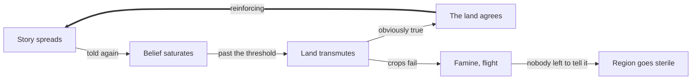

# Kith — Design Bible

*An original creature-collector built on one conceit: a story told often enough grows a body. Working draft — names are placeholders pending trademark clearance.*

## The premise

A story told often enough grows a body. These are **Kith** — not animals and not science, but local legend made flesh: the thing that drowns children in the millpond, the shape in the wheat, the ancestor who became a bird.

Every major system in this document falls out of that one sentence. Capture, progression, the open world, the ecology, the antagonist and the player's own identity are all consequences of myth being physical. Nothing here is bolted on to make a creature collector feel fresh.

It also does the legal work. A game about belief shaping terrain is not a game about catching animals in balls, so the distance from Pokémon is structural rather than cosmetic.

All proper nouns in this document are placeholders. "Kith," "Bleed," "Rumors" and "the Messenger" need a USPTO search before anything ships.

## Binding: learn the story, speak the name

You do not capture a Kith. You **learn its myth and say its true name**, and it comes with you.

Each Kith has a set of **verses** — fragments of its story scattered across the world in songs, grave markers, eroded carvings, drunks in taverns, and children's rhymes. Collect enough verses and the name becomes speakable. Collect all of them and you get the Kith's full reading, which unlocks its deeper moves and forms.

This replaces the catch-rate dice roll with a knowledge puzzle, which is better design on its own terms:

- **Rarity becomes obscurity.** A forgotten god is hard to bind because almost nobody still remembers it, not because the RNG said no.
- **The dex becomes a storybook you are writing**, not a checklist you are ticking.
- **Exploration has a reason.** Every settlement, ruin and roadside shrine might hold a verse, so the world is dense with cause to go look.

It also sidesteps the patent risk directly. The aim-and-throw capture flow is the specific thing Nintendo took Pocketpair to Tokyo District Court over, and that was a patent fight rather than a copyright one. Naming-as-binding is not a workaround of that flow — it is a different mechanic that happens to be more interesting.

## Cosmologies and translation

There is no universal type chart. **Each region thinks about the world in its own terms, and a Kith is re-read by whichever cosmology it currently stands in.**

One region reasons in humors. Another in celestial houses. Another in hungers and tides, another in colors, another in debts owed. Carry a Kith across a border and its typing is reinterpreted by the local system: matchups invert, some moves stop making sense, and others surface that were never available at home.

A myth changes when it is translated. That is true of real mythology and it is the single most important mechanic in the game.

What it buys:

- **Travel becomes the point**, not a reward for grinding. A region is gated by whether you can *read* it, not by whether your levels are high enough.
- **Every Kith has as many identities as there are cosmologies**, so a starter from hour one stays interesting in hour sixty.
- **Content multiplies without new assets.** Eight cosmologies means eight readings of the same creature.
- **It makes the villain's plan legible.** Someone flattening all cosmologies into one universal chart is destroying the thing the player spends the whole game learning to navigate.

Learning to read a cosmology is the real progression currency. See *Progression* below.

## The belief ledger

**Belief is the world-state variable.** Every region tracks, per myth, how widely that story is still told — a few hundred floating-point numbers rather than a combinatorial explosion of flags.

This is the design's load-bearing trick. Ten binary world-flags already means 1,024 possible worlds, each theoretically needing authored content, which is why "the world responds to your choices" almost always collapses into cosmetic changes or three endings and a slideshow. Belief dodges that entirely, because the player is moving *continuous values* that change **distribution and typing** on content that already exists.

How the player moves the numbers:

- Learn a Kith's verses and retell its story → belief rises → the species becomes more common in the wild, its moves hit harder, and forms unlock that exist only while the myth is strong.
- Neglect or actively suppress a myth → it fades → it grows rare, then regionally extinct.
- Carry a story across a border and tell it enough → the Kith begins appearing there, reinterpreted through the local cosmology.

**Belief is zero-sum within a region.** There is a fixed amount of attention in any population, so raising one myth necessarily fades another. This single constraint is what stops the system eating itself: without it, every player spreads the same top-tier myths and every save converges on identical meta sludge. With it, the player is tending a garden with limited water.

When a myth drops near zero it triggers a **last telling** — one chance to save it. Let it pass and the myth is gone from that save permanently. The event is generated by the simulation, not authored, and it is the emotional centerpiece of the whole system.

## Bleed

**A myth told too much stops being a story and becomes true. The land agrees with it.** Push belief past a threshold and local terrain begins transmuting toward that myth's domain.

A dominant fire myth turns a green valley volcanic. A drowning myth bogs the lowlands over. A hunger myth blights the soil and crops fail. Under-belief is its own death: a region where every myth has faded goes thin and featureless, because there is no story for anything to be.

The loop reinforces itself — volcanic terrain makes the fire myth *more* believable, because look around, it is obviously true. Some regions can therefore be past saving by the time the player arrives.

### What Bleed unlocks

**A reason to actively kill a myth.** Fading was previously passive neglect. Now suppression is deliberate and ugly: collect contradicting versions, seed a rival myth, get a Keeper to reassert their tradition. A whole verb set the game otherwise lacks, and every use strangles something somebody loves.

**Genuine irreversibility.** A region past the tipping point does not come back. The genre has never once let a place be truly lost, and it will be the most memorable thing in the game.

**Terraforming as strategy.** Some Kith should exist *only* in transmuted terrain — a thing that lives in fresh volcanic rock, a thing that wakes only in standing floodwater. Now deliberate Bleed is a real tactic with a real body count, and the dex completionist has to decide whether the last three entries are worth a valley.

### Two things to get right

**Telegraph it brutally.** If a player can irreversibly wreck a region by doing the core fun thing — catching creatures — that reads as a betrayal and they will disengage from the system out of anxiety. You need a long, loud, visible middle: grass yellowing, water tasting wrong, NPCs commenting, the Keeper warning you outright, and a clearly communicated point of no return *before* it is crossed. The land should beg the player to notice for hours before anything dies.

**Never purely punitive.** If the only correct play is avoidance, Bleed is a tax rather than a mechanic. It has to be a tool with a cost.

## People are the substrate

**Belief lives in people, which makes ordinary NPCs the most powerful force in the game.** This is the sharpest departure from Pokémon, where villagers are vending machines and set dressing.

A story needs an audience. Told in a city of ten thousand it moves the ledger hard; told to a hermit on a ridge it barely registers. Population density, literacy and oral-transmission rate are therefore regional stats.

**Population is simultaneously the engine and the hostage.** When Bleed kills a valley the people die or flee, and the region's capacity to hold *any* story collapses with them. You have not merely made a place ugly — you have made it mythically sterile, and nothing will live there again because nobody is left to believe anything.

**Refugees are how Bleed crosses borders.** People fleeing a dying region carry their myths out in their mouths, into whatever town shelters them. The fire myth does not abstractly spill over a mountain range; it walks over on foot, and the valley that took the refugees in starts getting warm. That is a mechanism and a tragedy at the same time.

Different vessels hold stories differently — elders, children, priests, a drunk who knows one verse nobody else does. When an old woman dies she takes her verses with her, which is a *last telling* with a face attached instead of a number hitting zero.

It also answers the question Pokémon never answers honestly: **why is the player special?** Not because they own strong creatures. Because they are the only one who travels. Everyone else holds their region's myths; the player carries myths between regions, in a world where myth is physics.

**Scope guardrail.** Do not simulate individuals. A settlement gets a population number, a transmission rate and a belief vector. Put faces on the dozen people who matter and let the rest be arithmetic. Agent-level oral-tradition simulation is a research project, not a first game.

## Syncretism

**Myths fuse when two of them are strongly believed in the same place.** This is emergent, not a creature creator, and the distinction is what keeps it from wrecking the game.

A player-facing fusion editor would be fatal. It means either procedural designs (Spore's creature creator was a delightful toy that produced visual noise) or modular pre-authored parts that always read as modular. The meta instantly becomes "find the broken combination." Worst of all it guts the core emotion: the engine of this game is that myths are *old* and *found*, that you are recovering something belonging to a place. Mintable myths turn the storybook into a workbench.

Syncretism is what real traditions actually do when they meet, and it fits the fiction exactly:

- **It happens, you do not do it.** Push two myths above a high belief threshold in one region and they merge on their own. You engineered the conditions; the world produced the result. Gardener, not designer.
- **It is expensive by construction.** Two saturated myths in one place means you deliberately shoved a region toward the Bleed cliff to get it. Every syncretic Kith costs a valley something real.
- **Results are authored, not generated.** Pre-write a finite set of pairs, hand-designed and properly strange. Players discover them like recipes, trade knowledge of them, and argue about which are worth the damage. Every save differs by *which pairs you unlocked*, with no procedural slop.
- **Syncretic Kith are unstable.** They sit in two cosmologies at once, so their typing never resolves cleanly — it flickers between readings. Powerful and unreliable.

The thematic knife: **force-merging cosmologies is exactly what the antagonist does.** Every syncretic Kith the player makes uses the villain's own method at small scale, and the game should quietly notice — a Keeper who stops speaking to you, a line that lands differently on a second playthrough. Do not punish it. Just let the player work it out somewhere around hour twenty.

Target 30–50 authored fusions at full scope. Four to six in the first region.

## Rumors

**Tell a story wrong on purpose and you get a Kith that should not exist.** Call them Rumors — myths born of deliberate falsehood rather than tradition.

A Rumor has no origin. Its verses contradict each other and trace back to nothing. There is no place it belongs to, no people who remember it, no season it arrives in.

**The bait:** because it belongs to no tradition, a Rumor **is not reinterpreted when it crosses a border.** It keeps its typing everywhere. In a game built entirely on translation, a creature that refuses to translate is enormously strong, and every player will want one.

**The cost:** a Rumor has no ecology. It does not feed a region's mythic health, it only consumes belief — and false stories spread faster than true ones, because they always do. A region carrying a Rumor bleeds with none of the compensating richness. Pure extraction.

**The social cost:** Keepers can tell. They have spent their lives inside their tradition's stories. Walk into a Keeper's hall with a Rumor on your belt and they know immediately, and some will refuse to speak to you again.

Then the late-game turn. The Messenger is the one being who can distinguish a true story from a false one — so when the player starts asking whether *they* are true, whether the myth of the Messenger was ever told honestly or whether somebody made them up, the mechanics have been asking that question for thirty hours before the plot gets around to it.

## The player is a Kith: the Messenger

**The player is not human. They are the myth of the messenger — the story about the one who carries stories.** Revealed late, roughly the final act.

It is the best kind of twist, because it is deducible from the mechanics rather than from planted diary pages. Two things the player has been doing since minute one only make sense in hindsight:

1. **Why can you bind a Kith by learning its story and speaking its name?** A person should not be able to do that. You can because you are made of story — the one myth whose function is carrying other myths.
2. **Why are you the only one who travels?** Because that is what your story says you do. Everyone else holds their region's myths. Moving between them is your domain.

And it detonates the stakes. If the antagonist is flattening every cosmology into one, the player is a thing that can be flattened too. Their victory does not threaten the world in the abstract — it erases *you*, specifically.

### You are subject to your own ledger

The Messenger has a belief value like everything else, and it has three attractors:

- **Faded.** Spread little and the story of the messenger thins. You get weaker, patchier, and start forgetting your own verses — but nothing is expected of a myth nobody tells. A strange, lonely, legitimate way to play.
- **The harbinger.** Wreck lands and the stories told about you turn dark. You become the one whose arrival means the valley will burn. Different form, different kit.
- **The green herald.** Tend lands and you become the myth of renewal, with a completely different ability set.

### No morality meter

Resist the reward/punishment framing. Morality meters are the weak version of this — Paragon/Renegade, Fable's halo. The moment a player sees the needle they optimize it and the choices stop being choices, and it puts the game in the position of *judging* the player rather than *reflecting* them.

The belief system already does this better. You are a myth, so what people believe about you is what you literally are. Your typing shifts because typing is a belief function like everything else. That is not punishment, it is consequence expressed in the game's own grammar — and it gives the whole system its visual payoff, because **the player character physically becomes what the world decided they were.**

## The antagonist

**Someone is syncretizing the world — forcibly merging every cosmology into one universal system so that no myth can ever hold local power again.**

They are not evil. They watched a region bleed out. They saw a valley become a crater and a few thousand people starve because a story got too popular, and they concluded that the only safe world is one where belief is flattened everywhere and no story can dominate anywhere. That is a reasonable person reaching a monstrous conclusion, which is the only kind of villain worth writing.

Which means the final boss of this game is, pointedly, **a universal type chart.** Pokémon's own structure as the dystopia. Put it on the back of the box.

Two strong options for who they are, not mutually exclusive:

- **A previous Messenger who saturated.** Over-believed, they became the thing that spreads every story into every other until borders dissolve. The player's own bad ending, walking around.
- **A council of Keepers who agreed.** Scarier, because it means the traditions chose this, and the player is the only one arguing for a world that can still hurt people.

The second-playthrough reading should be that the antagonist is *right about the diagnosis* and wrong about the cure. Bleed does kill valleys. The player does cause it. The game should never fully rebut that — only insist that a world incapable of local meaning is not worth the safety.

## Progression

**No gyms, no badges, no level staircase.** Progression is literacy in cosmologies, and it is parallel rather than sequential.

**Keepers.** Each region has two or three mythkeepers who test whether you understand their tradition. Beating one teaches you to *read* that cosmology, which unlocks the translation layer for that region. Any order, scaled to how many you have cleared globally.

**Renown instead of levels.** The more widely a Kith's story is known, the more it can hold. Power curve stays deliberately flat; Kith grow **sideways** — new verses unlock new forms and moves rather than bigger numbers. This is what lets the world stay open from hour one without every encounter turning to wet cardboard.

**Wild encounters stay regionally fixed.** You are not catching a late-game Kith outside its homeland no matter how strong you are, because it does not live there. Lore does the gating that levels usually do.

**Level caps you build into, not past.** Each Keeper's trial has a Renown ceiling. You cannot grind through it; you have to actually solve the matchups in that cosmology. Badges become horizontal — keys, not rungs.

## Endgame and persistence

**A finite narrative spine over an open ecological field.** These are different layers and they must not be asked to do each other's job — that mistake is why "the world responds to you" usually ships as three endings and a slideshow.

**The spine is finite.** There is a real ending: the syncretizer is resolved, roughly 25–35 hours, authored, with a climax. Narrative needs closure because meaning requires it, and an endless game has no shape.

**The field never closes.** The ending resolves the *threat*, not the *world*. The belief ledger keeps moving afterward, and the ecology you made is the one you keep. Your save has a measurably different creature distribution than anyone else's because you told different stories. That is the longevity, and it costs almost nothing because it is the same system already running.

**Win condition the genre does not have:** a full dex *and* a world that is not ruined. Most players will manage one. That is the right difficulty for a completionist goal, and it means the last three dex entries force a real decision about whether they are worth a valley.

**New Game+ inherits the world.** Your ending ecology becomes the next run's starting conditions — the myths you killed are still dead, the valley you cratered is still a crater. Cheap to implement, enormous hook, and thematically exact: the world remembers what you told it.

## Release model: one region at a time

**Ship region by region into a single growing world, not as separate numbered games.** This fits this design better than it would fit almost any other creature collector, for one specific reason.

**Every release appreciates the content you already own.** Pokémon's generational model makes the previous game a dead cartridge. Here, when a new region launches it brings a new cosmology — and every Kith the player already has gains a *new reading* under it. Old collections get more valuable, not obsolete. That is a genuinely unusual property and it is the entire argument for this model.

**Region 1 must be complete on its own.** No cliffhanger, no "buy the next one to find out." It is a finished story about one valley's myths, with the syncretizer as a distant rumor at the edges. The meta-plot accretes across releases rather than being withheld. Break this rule and you have poisoned the well for every subsequent launch.

**Translation needs two cosmologies, so Region 1 ships with two.** Use two internal traditions — highland and lowland, say — inside one region. The hook is demonstrable at launch, and every region afterward adds a third, fourth, fifth.

**One launcher, not separate executables.** The Hitman World of Assassination model: locations released over years, folded back into a single product. The premise of this game is that it is *one world*; shipping separate .exes would betray that at the structural level.

**Pricing shape.** Region 1 as a complete standalone at a lower price point, subsequent regions as paid expansions or a single world pass. Avoid the episodic-cliffhanger pattern — the Half-Life Episode 3 problem is a credibility wound you never recover from.

### The real engineering trap

**Save migration.** A player's region-1 world state — their belief ledger, which myths they let die, their Messenger form — has to carry forward into every future release, forever. That is a serialization and versioning burden that must be designed on **day one**, not patched in at region 2.

Concretely: version the save schema from the first commit, keep the belief ledger as data rather than code, never hardcode a myth list, and write the migration harness before you need it. This single decision is the difference between a model that compounds and one that collapses at the second launch.

## Staying clear of Pokémon

**Mechanics and systems are not copyrightable, and turn-based creature collecting has prior art back to Megami Tensei (1987) and Dragon Quest V (1992).** The genre itself is not the risk. Three specific things are.

| Risk | What it actually protects | What to do |
| --- | --- | --- |
| Copyright | Specific expression — creature designs, art, names, text, music | Silhouette test every design: if the shape alone reads as a known creature, redraw it |
| Trademark | Names, wordmarks, logos | No "Poké-" anything, no Gyms, no Badges, no Professor; clear all names through USPTO TESS before committing |
| Patents | Specific mechanical flows, notably aim-and-throw capture and creature-riding | Design around the flow rather than renaming it — naming-as-binding does this for free |

The Pocketpair suit is the one to understand: Nintendo and The Pokémon Company went after Palworld on **patents**, not copyright. Most developers assume the danger is in looking similar. The sharper danger is in replicating a patented interaction.

On creature design: build from real public-domain folklore motifs, but *design* fresh. Someone's 1890 illustration of a kelpie may still be under copyright in its specific rendition even where the folklore is not.

Half the items above are not legally required — dropping Gyms and the three-starters-from-a-lab opening is about removing the clone smell that gets you noticed in the first place. The best legal strategy is not looking like a clone.

**Get a real IP attorney before shipping.** This section is pattern-matching, not legal advice.

## Build order

**Dream the whole world; build the valley first.** Not because the design is too ambitious, but because the valley is how you prove the design works before you spend a year animating things.

### Prove this before anything else

Grey-box one valley, two internal cosmologies, six Kith, colored cubes for models. The question you are answering is narrow and critical: **does watching a myth saturate and a region bleed actually produce a feeling?** If yes, everything downstream is worth building. If no, you learned it in a month instead of in year three.

That is the single riskiest assumption in this document. Nothing else deserves to be tested first.

### Where ambition is free and where it isn't

| Cost type | Examples | Scales with |
| --- | --- | --- |
| Nearly free | Belief ledger, Bleed, cosmology translation, syncretism rules, Rumors | Design cleverness |
| Linear hours | Creature models, animation sets, cries, terrain states per region | Headcount and time |

The expensive half is the half that is *not* differentiating — Pokémon already has a thousand creatures. The cheap half is the half nobody else has. So go maximal on systems and treat content volume as an **art-direction** problem rather than a sacrifice.

### Art direction chosen to scale

Pick a style that is producible at volume by a small team: silhouette-driven, bold shapes, limited palette per cosmology. Cassette Beasts got enormous mileage from a style selected to be shippable. Let the palette shift carry the translation mechanic visually — the same Kith rendered in the northern palette versus the desert one is cheap and reads instantly.

### Terrain states

Bleed means multiple authored visual states per region, which is real art money. Region 1 gets **one valley, two domains** — it can go lush-overgrown or volcanic-barren, with a stable middle. Prove the loop reads with two states before promising eight.

### Engine

Godot for a small team: no royalties, good 2D and 3D, and it will not fight you. Build data-driven from the first commit — Kith definitions, verse fragments, cosmology mappings and the belief ledger all live in external resource files, never hardcoded. The moment you add cosmology three you will be regenerating every matchup table in the game.

## Open questions

- [ ] **Where does the player's leverage sit?** Incidental (you spread stories as a side effect of collecting) or deliberate (you are explicitly a myth-keeper choosing what survives, and collecting serves that)? The second is heavier and more interesting but a harder sell to someone who just wants to catch cool monsters.
- [ ] **How is the belief ledger surfaced?** The player must be able to *see* regional belief state or none of this lands. A map overlay is the obvious answer and probably not the best one.
- [ ] **Can the player decline to be the Messenger?** If identity is belief-driven, is there a route where you refuse the role entirely — and what happens to a myth that rejects its own story?
- [ ] **How reversible is Bleed?** There has to be a point of no return for the tragedy to land, but if the catch loop can accidentally ruin a region, players disengage from the system out of anxiety. Needs a long, loud, visible middle.
- [ ] **Combat system.** Entirely unspecified so far. Turn-based is the genre default, but the translation mechanic might support something stranger — a myth-argument rather than a fight.
- [ ] **Multiplayer.** Trading verses rather than creatures is an obvious fit. Shared-world belief is a much bigger and riskier idea.
- [ ] **Name clearance.** Kith, Bleed, Rumors, the Messenger, Renown, Keepers — all need a USPTO TESS search.
